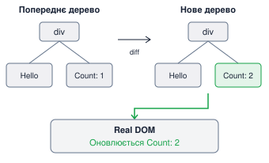
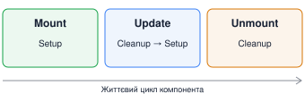
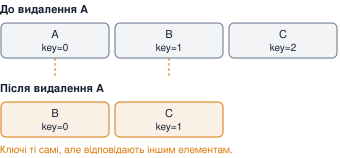
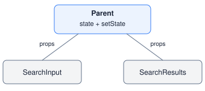
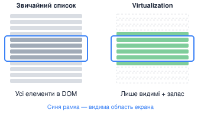

# React

## 3.1. Що таке Virtual DOM?

<a id="q-3-1"></a>

### Пояснення

#### Interview answer (EN)

React calculates the desired UI during render and applies necessary DOM changes during commit.

Virtual DOM — представлення бажаної структури інтерфейсу у пам'яті, з яким React працює під час рендерингу.

React формує нове представлення UI, визначає необхідні зміни та застосовує їх до реального DOM на етапі commit.

Важливо: Virtual DOM не означає, що React завжди швидший за прямі DOM-операції. Це механізм декларативного та ефективного керування UI.



## 3.2. Як працює reconciliation?

<a id="q-3-2"></a>

### Пояснення

#### Interview answer (EN)

React matches elements by identity in the tree. A changed key or type can reset a subtree.

Reconciliation — процес визначення того, як нове дерево React відповідає попередньому.

React використовує, зокрема, тип елемента, його позицію та `key`.

Якщо тип компонента залишається тим самим, React зазвичай зберігає його стан. Якщо тип або `key` змінюється, компонент може бути демонтований і створений заново.

```typescript
<UserProfile key={userId} />
```

Зміна `userId` у цьому прикладі призведе до скидання локального стану `UserProfile`.

#### Пов’язані питання

- [Чому не рекомендується використовувати індекс масиву як `key`?](#q-3-14)

## 3.3. Що спричиняє повторний рендер компонента?

<a id="q-3-3"></a>

### Пояснення

#### Interview answer (EN)

A component can render after a state update, a parent render, or a changed context that it reads.

Основні причини:

- Оновлення локального state.
- Рендер батьківського компонента.
- Зміна значення Context, який використовує компонент.
- Оновлення зовнішнього store, на який підписаний компонент.

React може пропустити деякі оновлення, наприклад коли нове значення state ідентичне старому за `Object.is`.

Важливо розрізняти render та commit: повторний виклик функції компонента не обов'язково означає зміну реального DOM.

## 3.4. Чи ререндериться дочірній компонент, якщо його props не змінилися?

<a id="q-3-4"></a>

### Пояснення

#### Interview answer (EN)

A parent render normally renders its children too. Memoization can skip a child when its inputs are unchanged.

За замовчуванням — так, якщо рендериться його батьківський компонент.

```typescript
function Parent() {
  const [count, setCount] = useState(0);

  return (
    <>
      <button onClick={() => setCount(count + 1)}>
        {count}
      </button>

      <Child name="Alex" />
    </>
  );
}
```

`Child` зазвичай буде повторно викликаний, навіть якщо `name` не змінився.

Для оптимізації можна використати:

```typescript
const Child = React.memo(function Child({ name }) {
  return <div>{name}</div>;
});
```

Але `React.memo` не блокує оновлення власного state або Context. React Compiler, якщо використовується, також може автоматично оптимізувати такі випадки.

## 3.5. У чому різниця між `useMemo`, `useCallback` та `React.memo`?

<a id="q-3-5"></a>

### Пояснення

#### Interview answer (EN)

UseMemo caches a computed result, useCallback retains a function reference, and memo can skip component rendering for unchanged props.

| Інструмент | Що мемоізує |
| --- | --- |
| `useMemo` | Результат обчислення |
| `useCallback` | Посилання на функцію |
| `React.memo` | Дозволяє пропускати рендер компонента при незмінних props |

```typescript
const filteredUsers = useMemo(
  () => users.filter(user => user.active),
  [users]
);
```

```typescript
const handleClick = useCallback(() => {
  doSomething(id);
}, [id]);
```

```typescript
const UserList = React.memo(UserListComponent);
```

Їх часто використовують разом, щоб зберігати стабільні props для мемоізованих компонентів.

#### Пов’язані питання

- [Коли мемоізація може погіршити продуктивність?](#q-3-6)
- [Як знайти причину повільної роботи React-застосунку?](../08-architecture/README.md#q-8-9)

## 3.6. Коли мемоізація може погіршити продуктивність?

<a id="q-3-6"></a>

### Пояснення

#### Interview answer (EN)

Memoization adds comparisons and bookkeeping. Measure whether the avoided work outweighs those costs.

Мемоізація також має вартість: збереження значень у пам'яті, порівняння залежностей та props, додаткова складність коду.

```typescript
const fullName = useMemo(
  () => firstName + " " + lastName,
  [firstName, lastName]
);
```

Тут мемоізація, найімовірніше, зайва, оскільки саме обчислення дуже дешеве.

Краще оптимізувати після вимірювання продуктивності за допомогою React Profiler, а не обгортати кожну функцію в `useCallback`.

## 3.7. Як працює `useEffect`?

<a id="q-3-7"></a>

### Пояснення

#### Interview answer (EN)

An effect synchronizes a component with an external system and can resynchronize when its reactive dependencies change.

`useEffect` використовується для синхронізації компонента із зовнішніми системами: API, subscriptions, timers, браузерними API.

```typescript
useEffect(() => {
  document.title = title;
}, [title]);
```

| Залежності | Поведінка |
| --- | --- |
| Не передані | Після кожного відповідного commit |
| `[]` | Після монтування |
| `[value]` | Після монтування та зміни value |

React порівнює залежності за допомогою `Object.is`.

У development-режимі Strict Mode може додатково виконувати цикл setup → cleanup → setup.

#### Пов’язані питання

- [Коли виконується cleanup-функція в `useEffect`?](#q-3-8)
- [Що таке stale closure?](#q-3-12)
- [useEffect](../09-live-coding/README.md#q-9-4)

## 3.8. Коли виконується cleanup-функція в `useEffect`?

<a id="q-3-8"></a>

### Пояснення

#### Interview answer (EN)

React cleans up before resynchronizing an effect and when the component unmounts.

Cleanup виконується перед наступним запуском effect зі зміненими залежностями та при демонтуванні компонента.

```typescript
useEffect(() => {
  window.addEventListener("resize", handleResize);

  return () => {
    window.removeEventListener(
      "resize",
      handleResize
    );
  };
}, [handleResize]);
```

Cleanup необхідний для запобігання memory leaks, дублюванню subscriptions та небажаним ефектам.



## 3.9. Чим відрізняються `useEffect` та `useLayoutEffect`?

<a id="q-3-9"></a>

### Пояснення

#### Interview answer (EN)

UseLayoutEffect runs before the browser paints the committed update. Ordinary effects are appropriate for most external synchronization.

`useLayoutEffect` виконується після змін DOM, але перед тим, як браузер перемалює екран. Він може блокувати відображення.

`useEffect` зазвичай виконується після paint, хоча React не гарантує цього для всіх сценаріїв.

`useLayoutEffect` корисний, коли необхідно виміряти DOM і скоригувати layout до того, як користувач побачить результат.

```typescript
useLayoutEffect(() => {
  const rect = ref.current.getBoundingClientRect();
  setHeight(rect.height);
}, []);
```

За замовчуванням краще використовувати `useEffect`.

## 3.10. Чим відрізняються `useRef` та `useState`?

<a id="q-3-10"></a>

### Пояснення

#### Interview answer (EN)

A ref stores a mutable value across renders without causing a render. State updates request a render.

| Характеристика | useRef | useState |
| --- | --- | --- |
| Зберігає значення між рендерами | Так | Так |
| Оновлення викликає ререндер | Ні | Зазвичай так |
| Можна змінювати напряму | Так | Ні |
| Доступ до DOM | Так | Не основне призначення |

```typescript
const inputRef = useRef<HTMLInputElement>(null);

inputRef.current?.focus();
```

```typescript
const [count, setCount] = useState(0);
```

`useRef` підходить для DOM elements, timer IDs та mutable values, які не повинні впливати на відображення UI.

## 3.11. Чому не можна викликати hooks умовно?

<a id="q-3-11"></a>

### Пояснення

#### Interview answer (EN)

Ordinary hooks must be called in a consistent order so React can associate each call with its state.

React використовує порядок викликів hooks для зіставлення їхнього стану між рендерами.

Неправильно:

```typescript
if (isLoggedIn) {
  const [user, setUser] = useState(null);
}
```

Якщо умова зміниться, порядок викликів hooks порушиться.

Правильно:

```typescript
const [user, setUser] = useState(null);

useEffect(() => {
  if (isLoggedIn) {
    fetchUser();
  }
}, [isLoggedIn]);
```

Звичайні hooks потрібно викликати на верхньому рівні React-компонентів або custom hooks. Окремий виняток — React API `use`, яке допускає умовні виклики за своїми правилами.

## 3.12. Що таке stale closure?

<a id="q-3-12"></a>

### Пояснення

#### Interview answer (EN)

A stale closure reads values from an older render. Dependencies and functional updates help address different cases.

Ситуація, коли функція використовує застарілі значення з попереднього рендера через замикання.

```typescript
const [count, setCount] = useState(0);

useEffect(() => {
  const timer = setInterval(() => {
    console.log(count);
  }, 1000);

  return () => clearInterval(timer);
}, []);
```

Тут `count` завжди буде дорівнювати 0, оскільки effect захопив значення першого рендера.

Варіанти вирішення залежать від ситуації: коректні dependencies, functional updates, `useRef` для актуального значення або `useEffectEvent` для відповідних сценаріїв.

Наприклад:

```typescript
setCount(prev => prev + 1);
```

## 3.13. Як працює batching оновлень стану?

<a id="q-3-13"></a>

### Пояснення

#### Interview answer (EN)

Batching groups state updates. Functional updaters receive the pending state in the queue.

Batching — групування декількох оновлень state для зменшення кількості рендерів.

```typescript
setName("Alex");
setAge(30);
setLoading(false);
```

React зазвичай об'єднає ці оновлення в один рендер.

Починаючи з React 18 із сучасним root API, automatic batching також працює для багатьох асинхронних сценаріїв, зокрема Promise та timers.

Важливо: state у функції компонента є snapshot конкретного рендера. Виклик setter не змінює поточну локальну змінну негайно.

#### Пов’язані питання

- [React State](../09-live-coding/README.md#q-9-3)

## 3.14. Чому не рекомендується використовувати індекс масиву як `key`?

<a id="q-3-14"></a>

### Пояснення

#### Interview answer (EN)

An index key can associate state with the wrong item when a list is reordered, inserted into, or shortened.

React використовує `key` для ідентифікації елементів між рендерами.

```typescript
items.map((item, index) => (
  <Item key={index} item={item} />
));
```

Якщо видалити, додати або перемістити елемент, індекси зміняться, і React може пов'язати стан компонента з неправильним елементом.

Правильніше:

```typescript
items.map(item => (
  <Item key={item.id} item={item} />
));
```

Індекс може бути прийнятним для статичних списків, порядок та склад яких ніколи не змінюються.



## 3.15. Що таке controlled та uncontrolled components?

<a id="q-3-15"></a>

### Пояснення

#### Interview answer (EN)

A controlled input takes its value from React state. An uncontrolled input keeps its current value in the DOM.

Controlled component — значення контролюється React state.

```typescript
const [value, setValue] = useState("");

<input
  value={value}
  onChange={e => setValue(e.target.value)}
/>
```

Uncontrolled component — значення зберігається в DOM.

```typescript
const inputRef = useRef<HTMLInputElement>(null);

<input ref={inputRef} defaultValue="Hello" />
```

Controlled зручні для динамічної валідації та синхронізації UI. Uncontrolled дозволяють уникати деяких зайвих оновлень і можуть бути зручними для великих форм.

## 3.16. Що таке lifting state up?

<a id="q-3-16"></a>

### Пояснення

#### Interview answer (EN)

Move shared state to the closest common parent and pass values and callbacks down.

Переміщення спільного стану до найближчого спільного батьківського компонента, щоб синхронізувати декілька дочірніх компонентів.

Наприклад, `SearchInput` змінює пошуковий текст, а `SearchResults` використовує його. Обидва отримують необхідні дані від батьківського компонента.



## 3.17. Що таке React Portal?

<a id="q-3-17"></a>

### Пояснення

#### Interview answer (EN)

A portal puts DOM content in another container while retaining its place in the React tree.

Portal дозволяє рендерити React-компонент в іншому місці DOM, зберігаючи його місце в React-дереві.

```typescript
return createPortal(
  <Modal />,
  document.body
);
```

Використовується для modals, tooltips, popovers та overlays.

Допомагає уникнути проблем із `overflow: hidden`, stacking contexts та позиціонуванням.

React Context і поширення React events продовжують працювати відповідно до React-дерева.

## 3.18. Як працюють Error Boundaries?

<a id="q-3-18"></a>

### Пояснення

#### Interview answer (EN)

An error boundary can show fallback UI when a descendant throws during rendering.

Error Boundary перехоплює помилки під час рендерингу дочірнього дерева та показує fallback UI замість падіння всього застосунку.

```typescript
<ErrorBoundary fallback={<ErrorPage />}>
  <Application />
</ErrorBoundary>
```

Нативна реалізація базується на class components і методах `getDerivedStateFromError` та `componentDidCatch`. Також існують готові бібліотеки.

Error Boundaries зазвичай не перехоплюють помилки в event handlers, довільних асинхронних callbacks, SSR або помилки самого boundary.

## 3.19. Що таке custom hooks і коли їх варто створювати?

<a id="q-3-19"></a>

### Пояснення

#### Interview answer (EN)

A custom hook extracts reusable stateful behavior. Each call has its own hook state.

Custom hook — функція, назва якої починається з `use` і яка дозволяє повторно використовувати stateful React-логіку.

```typescript
function useToggle(initial = false) {
  const [value, setValue] = useState(initial);

  const toggle = () => setValue(prev => !prev);

  return { value, toggle };
}
```

Custom hooks допомагають відокремлювати бізнес-логіку від UI та уникати дублювання.

Важливо: два компоненти, які викликають один custom hook, не отримують автоматично спільний state.

## 3.20. Навіщо потрібен Strict Mode?

<a id="q-3-20"></a>

### Пояснення

#### Interview answer (EN)

Strict Mode runs extra development checks that help reveal impure rendering and missing effect cleanup.

Strict Mode допомагає виявляти потенційні проблеми в development-режимі.

```typescript
<StrictMode>
  <App />
</StrictMode>
```

Зокрема, React може додатково викликати функцію компонента, повторно запускати effects та ref callbacks для виявлення нечистого рендерингу і відсутнього cleanup.

Ці додаткові перевірки не впливають на production.

## 3.21. Як працюють `React.lazy` та `Suspense`?

<a id="q-3-21"></a>

### Пояснення

#### Interview answer (EN)

Lazy loads a component on demand. Suspense supplies a fallback while supported children suspend.

`React.lazy` дозволяє завантажувати код компонента лише тоді, коли він потрібен.

```typescript
const Settings = lazy(() => import("./Settings"));

<Suspense fallback={<Spinner />}>
  <Settings />
</Suspense>
```

`Suspense` показує fallback, поки дочірній компонент призупинив рендеринг, наприклад очікуючи завантаження коду.

Також Suspense може працювати з підтримуваними механізмами завантаження даних, але не перехоплює автоматично звичайний `fetch` усередині `useEffect`.

## 3.22. Що таке `useTransition` та `useDeferredValue`?

<a id="q-3-22"></a>

### Пояснення

#### Interview answer (EN)

Transitions mark updates as non-urgent. A deferred value lets expensive consumers lag behind an urgent input.

Ці hooks допомагають розділяти термінові та менш термінові оновлення UI.

```typescript
const [isPending, startTransition] = useTransition();

function handleChange(value: string) {
  setInput(value);

  startTransition(() => {
    setSearch(value);
  });
}
```

`useTransition` позначає певні оновлення state як нетермінові.

`useDeferredValue` дозволяє відкласти використання нового значення в менш пріоритетній частині UI.

```typescript
const deferredSearch = useDeferredValue(search);
```

Наприклад, користувач може продовжувати друкувати в input, поки React працює над оновленням великого списку результатів.

Це не debounce і не спосіб прискорити самі важкі обчислення — це керування пріоритетом рендерингу.

## 3.23. У яких випадках не потрібно використовувати `useEffect`?

<a id="q-3-23"></a>

### Пояснення

#### Interview answer (EN)

Compute derived values while rendering and handle direct user actions in event handlers when no external synchronization is needed.

Коли значення можна отримати безпосередньо під час рендера.

Неправильно:

```typescript
const [fullName, setFullName] = useState("");

useEffect(() => {
  setFullName(firstName + " " + lastName);
}, [firstName, lastName]);
```

Правильно:

```typescript
const fullName = firstName + " " + lastName;
```

Також не варто використовувати effect для обробки конкретної дії користувача, якщо її можна виконати безпосередньо в event handler.

Effects призначені передусім для синхронізації із зовнішніми системами.

## 3.24. Як би ти оптимізував компонент, який рендерить тисячі елементів?

<a id="q-3-24"></a>

### Пояснення

#### Interview answer (EN)

Measure first. Virtualize a long list, then inspect expensive rows and unnecessary renders.

Спочатку потрібно визначити bottleneck за допомогою React Profiler та browser Performance tools.

Можливі рішення: virtualization, pagination, lazy loading, мемоізація, оптимізація selectors та обчислень.

Virtualization за допомогою, наприклад, TanStack Virtual дозволяє рендерити лише елементи, які користувач бачить, та невеликий запас навколо них.


