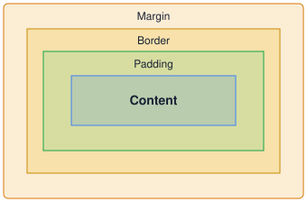
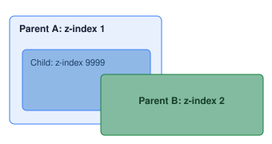

# HTML та CSS

## 5.1. Що таке семантичний HTML?

<a id="q-5-1"></a>

### Пояснення

#### Interview answer (EN)

Semantic HTML uses elements that describe content and behavior, which helps browsers and assistive technology.

Використання HTML-елементів відповідно до їхнього призначення.

```html
<header>
  <nav>Navigation</nav>
</header>

<main>
  <article>Content</article>
</main>

<footer>Footer</footer>
```

Замість використання `div` для всього краще застосовувати `button`, `nav`, `article`, `section`, `main` та інші відповідні елементи.

Це покращує accessibility, зрозумілість коду, підтримку assistive technologies та може допомогти SEO.

## 5.2. Як працює CSS specificity?

<a id="q-5-2"></a>

### Пояснення

#### Interview answer (EN)

Specificity compares selectors after higher-priority cascade rules have been resolved.

Specificity визначає пріоритет CSS-селекторів у межах відповідного рівня каскаду.

| Селектор | Specificity |
| --- | --- |
| `#header` | `1-0-0` |
| `.button.active` | `0-2-0` |
| `.button` | `0-1-0` |
| `button` | `0-0-1` |
| `*` | `0-0-0` |

Умовна ієрархія specificity селекторів, а не арифметична шкала.

ID має більшу специфічність, ніж будь-яка кількість класів. Клас має більшу специфічність, ніж селектор елемента.

При однаковій специфічності за інших рівних умов перемагає правило, оголошене пізніше.

`!important`, inline styles, cascade layers та походження стилів також впливають на результат каскаду.

## 5.3. Що таке CSS Box Model?

<a id="q-5-3"></a>

### Пояснення

#### Interview answer (EN)

The CSS box model describes the content, padding, border, and margin around an element.

Кожен HTML-елемент має прямокутну модель із content, padding, border та margin.

Content — вміст елемента. Padding — внутрішній відступ. Border — рамка. Margin — зовнішній відступ.



## 5.4. Чим відрізняються `content-box` та `border-box`?

<a id="q-5-4"></a>

### Пояснення

#### Interview answer (EN)

Content-box measures content width. Border-box includes padding and border in the assigned width.

При `width: 200px`, відступі `20px` і рамці `5px` з кожного боку:

| Модель | Зовнішня ширина | Ширина вмісту |
| --- | ---: | ---: |
| `content-box` | 250 px | 200 px |
| `border-box` | 200 px | 150 px |

При `content-box` width визначає лише розмір content. Padding та border додаються зверху.

При `border-box` width уже включає padding та border.

Тому часто використовують глобальний стиль:

```css
*, *::before, *::after {
  box-sizing: border-box;
}
```

## 5.5. Коли використовувати Flexbox, а коли Grid?

<a id="q-5-5"></a>

### Пояснення

#### Interview answer (EN)

Flexbox is useful for one-dimensional alignment. Grid handles rows and columns together.

Flexbox призначений переважно для одновимірного layout — рядка або колонки.

Grid — для двовимірного layout із рядками та колонками одночасно.

Flexbox

Navbar, кнопки, вирівнювання

Grid

Dashboard, галерея, layout сторінки

Їх можна і часто потрібно комбінувати.


## 5.6. Чим відрізняються `relative`, `absolute`, `fixed` та `sticky`?

<a id="q-5-6"></a>

### Пояснення

#### Interview answer (EN)

Relative stays in flow. Absolute and fixed are out of flow, and sticky switches behavior at a scroll threshold.

| Position | Поведінка |
| --- | --- |
| `static` | Звичайний потік документа |
| `relative` | Зміщення відносно власної позиції |
| `absolute` | Позиціонування відносно containing block |
| `fixed` | Зазвичай відносно viewport |
| `sticky` | Залишається в потоці, але прилипає при скролі |

Для `absolute` containing block часто створює найближчий позиціонований предок.

`fixed` та `absolute` видаляються зі звичайного потоку документа.

Для `sticky` необхідно задати відповідний inset, наприклад `top: 0`, та враховувати scroll container.

## 5.7. Що таке stacking context? Чому іноді не працює `z-index`?

<a id="q-5-7"></a>

### Пояснення

#### Interview answer (EN)

A stacking context orders descendants within its own layer. A child's z-index is compared within that context.

Stacking context — ізольований контекст накладання елементів.

`z-index` порівнюється в межах відповідного stacking context, а не глобально між усіма елементами сторінки.

Навіть якщо дочірній елемент має `z-index: 9999`, він не зможе перекрити сусідній stacking context, який розташований вище за його батьківський.

Stacking context можуть створювати `transform`, `opacity` менше 1, `isolation: isolate`, деякі комбінації `position` та `z-index`.



## 5.8. Чим відрізняються `display: none`, `visibility: hidden` та `opacity: 0`?

<a id="q-5-8"></a>

### Пояснення

#### Interview answer (EN)

Display none removes layout participation. Visibility hidden preserves space. Opacity zero makes an element visually transparent.

| Властивість | Займає місце | Видимий | Зазвичай інтерактивний |
| --- | --- | --- | --- |
| `display: none` | Ні | Ні | Ні |
| `visibility: hidden` | Так | Ні | Ні |
| `opacity: 0` | Так | Ні | Так |

`opacity: 0` робить елемент прозорим, але він може продовжувати отримувати кліки та keyboard focus.

Для коректної доступності потрібно враховувати не лише візуальне відображення, а й accessibility tree.

## 5.9. Чим відрізняються `px`, `em`, `rem`, `vh`, `dvh`?

<a id="q-5-9"></a>

### Пояснення

#### Interview answer (EN)

Rem relates to the root font size, em to font size in context, and viewport units to viewport dimensions.

| Одиниця | Відносно чого |
| --- | --- |
| `px` | CSS-пікселя |
| `em` | Розміру шрифту елемента, а для font-size — батьківського |
| `rem` | Розміру шрифту кореневого елемента |
| `vw` | Ширини viewport |
| `vh` | Висоти великого viewport |
| `dvh` | Поточної динамічної висоти viewport |

На мобільних пристроях `100dvh` може бути зручнішим за `100vh`, тому що враховує зміну доступної висоти при появі та зникненні браузерних панелей.

## 5.10. Що таке accessibility та ARIA-атрибути?

<a id="q-5-10"></a>

### Пояснення

#### Interview answer (EN)

Accessibility supports different ways of interacting. Native semantics come first, while ARIA supplies missing semantics when needed.

Accessibility — створення інтерфейсів, доступних користувачам із різними фізичними та когнітивними можливостями.

Приклади: семантичний HTML, keyboard navigation, правильні labels, достатній контраст, видимий focus та підтримка screen readers.

```typescript
<button aria-label="Close dialog">
  <CloseIcon />
</button>
```

ARIA додає інформацію для assistive technologies, але сама по собі не реалізує поведінку.

Наприклад, `role="button"` на `div` не робить його автоматично доступним із клавіатури. Краще використовувати нативний `button`.

#### Пов’язані питання

- [Як зробити модальне вікно доступним для клавіатурної навігації?](#q-5-11)

## 5.11. Як зробити модальне вікно доступним для клавіатурної навігації?

<a id="q-5-11"></a>

### Пояснення

#### Interview answer (EN)

Give the dialog a name, handle initial and return focus, keep keyboard focus inside while modal, and support dismissal.

Модальне вікно повинно мати доступну назву, отримувати focus при відкритті, утримувати keyboard focus всередині, підтримувати закриття через Escape та повертати focus до елемента, який його відкрив.

Також потрібно заблокувати взаємодію з фоновим контентом.

```typescript
<div
  role="dialog"
  aria-modal="true"
  aria-labelledby="dialog-title"
>
  <h2 id="dialog-title">Settings</h2>
</div>
```

Самих ARIA-атрибутів недостатньо — потрібно реалізувати поведінку. Можна використовувати нативний `<dialog>` із `showModal()` або перевірені UI-компоненти.
