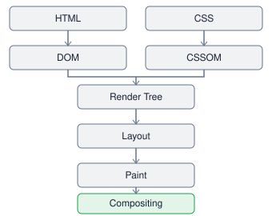
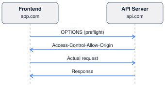
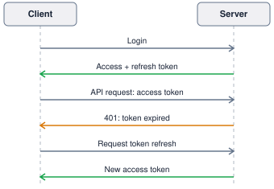
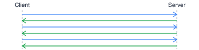
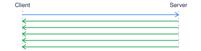
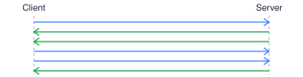

# Браузер, мережа та веббезпека

## 6.1. Що відбувається після введення URL в адресний рядок браузера?

<a id="q-6-1"></a>

### Пояснення

#### Interview answer (EN)

The browser resolves and connects when necessary, requests the resource, processes the response and renders the result.

```flow
URL parsing | Браузер аналізує адресу та перевіряє кеш
DNS resolution | Визначає IP-адресу сервера
Connection | Встановлює з’єднання, для HTTPS використовується TLS
HTTP request | Надсилає запит на сервер
HTTP response | Отримує HTML та інші дані
Parsing | Створює DOM і завантажує ресурси
Rendering | Обчислює layout, виконує paint і compositing
```

Це спрощена послідовність. Частина кроків може виконуватися паралельно, пропускатися через кеш або використовувати вже відкрите з'єднання. HTTP/3, наприклад, використовує QUIC замість TCP.

## 6.2. Як браузер рендерить сторінку?

<a id="q-6-2"></a>

### Пояснення

#### Interview answer (EN)

The browser parses HTML and CSS, lays out elements, paints content and composites layers.

HTML перетворюється на DOM, CSS — на CSSOM. Браузер визначає стилі та структури для відображення, розраховує позиції й розміри елементів, малює їх та компонує шари.

JavaScript може змінювати DOM і стилі, спричиняючи повторне виконання частини цього процесу.



## 6.3. Що таке DOM та CSSOM?

<a id="q-6-3"></a>

### Пояснення

#### Interview answer (EN)

The DOM models the document. The CSSOM represents styles and supports browser style processing.

DOM — Document Object Model. Деревоподібне представлення HTML-документа, доступне через JavaScript.

```javascript
document.querySelector(".button");
```

CSSOM — CSS Object Model. Представлення CSS-правил та стилів, з якими браузер і JavaScript можуть працювати.

```javascript
document.styleSheets;
getComputedStyle(element);
```

Браузер використовує інформацію про DOM та CSS для розрахунку стилів і відображення сторінки.

## 6.4. Що таке reflow, repaint та compositing?

<a id="q-6-4"></a>

### Пояснення

#### Interview answer (EN)

Layout calculates geometry. Paint draws visual content. Compositing puts rendered layers together.

| Операція | Що відбувається | Приклад зміни |
| --- | --- | --- |
| Reflow / Layout | Перерахунок геометрії | width, height |
| Repaint | Перемальовування | color, background |
| Compositing | Компонування шарів | transform, opacity у відповідних умовах |

Layout може бути особливо дорогим, оскільки зміна одного елемента здатна вплинути на інші елементи.

Для анімацій часто краще використовувати:

```css
transform: translateX(100px);
```

Замість:

```css
left: 100px;
```

`transform` та `opacity` можуть оброблятися лише на етапі compositing, але це залежить від того, як браузер організував шари.

#### Пов’язані питання

- [Що таке Core Web Vitals — LCP, INP та CLS?](../08-architecture/README.md#q-8-10)

## 6.5. Що таке CORS? Навіщо потрібен preflight request?

<a id="q-6-5"></a>

### Пояснення

#### Interview answer (EN)

CORS governs whether browser scripts may read responses from another origin. Some requests first trigger an OPTIONS preflight.

CORS — Cross-Origin Resource Sharing. Механізм, який дозволяє серверу повідомити браузеру, чи може JavaScript з іншого origin отримати доступ до відповіді.

Origin визначається схемою, доменом та портом.

Для певних запитів браузер спочатку відправляє `OPTIONS` — preflight request, щоб перевірити дозволені методи, origins та headers.

CORS контролюється браузером і налаштовується на сервері. Він не замінює authentication або authorization.

Не всі cross-origin запити потребують preflight.



## 6.6. Чим відрізняються `localStorage`, `sessionStorage` та cookies?

<a id="q-6-6"></a>

### Пояснення

#### Interview answer (EN)

Local storage persists across sessions, session storage is scoped to a tab session, and cookies can accompany HTTP requests.

| Характеристика | localStorage | sessionStorage | Cookies |
| --- | --- | --- | --- |
| Тривалість | До очищення або видалення | Сесія вкладки | Налаштовується |
| Автоматично надсилається серверу | Ні | Ні | За відповідних умов |
| Типовий обсяг | Кілька MB | Кілька MB | Приблизно 4 KB на cookie |
| Доступ із JavaScript | Так | Так | Не для HttpOnly |
| Призначення | Налаштування | Тимчасові дані | Сесії, авторизація |

Cookies підтримують додаткові security attributes: `HttpOnly`, `Secure`, `SameSite`.

Дані в `localStorage` доступні JavaScript, тому можуть бути викрадені внаслідок XSS.

## 6.7. Що таке XSS та CSRF? Як від них захиститися?

<a id="q-6-7"></a>

### Пояснення

#### Interview answer (EN)

XSS runs injected script in a trusted context. CSRF induces an authenticated cross-site action. Each has distinct defenses.

**XSS — Cross-Site Scripting.** Атака, при якій шкідливий JavaScript виконується в контексті сайту.

Захист: escaping, sanitization, Content Security Policy, уникнення небезпечного вставлення HTML.

React за замовчуванням екранує текстові значення, але `dangerouslySetInnerHTML` потребує особливої уваги.

**CSRF — Cross-Site Request Forgery.** Атака, при якій користувача змушують виконати небажаний запит до іншого сайту, де він уже авторизований.

Захист: CSRF tokens, `SameSite` cookies, перевірка Origin та коректне використання HTTP-методів.

Головна різниця: XSS виконує сторонній код у контексті сайту, CSRF зловживає автоматично переданими credentials користувача.

## 6.8. Чим відрізняються HTTP-методи `POST`, `PUT` та `PATCH`?

<a id="q-6-8"></a>

### Пояснення

#### Interview answer (EN)

POST submits data for processing. PUT replaces a resource representation, and PATCH applies partial changes.

| Метод | Типове призначення | Ідемпотентність |
| --- | --- | --- |
| GET | Отримання даних | Так |
| POST | Створення або виконання операції | Не гарантується |
| PUT | Створення або повна заміна ресурсу за URI | Так |
| PATCH | Часткове оновлення ресурсу | Не гарантується |
| DELETE | Видалення ресурсу | Так |

Ідемпотентність означає, що повторення однакового запиту має той самий очікуваний ефект на стан сервера, що й один запит.

Наприклад, повторний DELETE може повернути 404 замість 204, але ресурс усе одно залишається видаленим.

## 6.9. Що означають статус-коди 401, 403, 409, 422 та 500?

<a id="q-6-9"></a>

### Пояснення

#### Interview answer (EN)

Read the status together with the response contract. Common classes cover success, client errors and server errors.

| Код | Значення |
| --- | --- |
| 200 | OK |
| 201 | Created |
| 204 | No Content |
| 301 | Permanent Redirect |
| 304 | Not Modified |
| 400 | Bad Request |
| 401 | Unauthorized — потрібна автентифікація |
| 403 | Forbidden — доступ заборонено |
| 404 | Not Found |
| 409 | Conflict |
| 422 | Unprocessable Content |
| 429 | Too Many Requests |
| 500 | Internal Server Error |
| 502 | Bad Gateway |
| 503 | Service Unavailable |

Особливо часто запитують різницю між 401 та 403.

401 означає, що запит не має коректних authentication credentials. 403 означає, що сервер відмовляється виконувати запит, наприклад через недостатні дозволи.

## 6.10. Як працює access token та refresh token?

<a id="q-6-10"></a>

### Пояснення

#### Interview answer (EN)

An access token authorizes requests. A refresh token obtains a new access token when the session permits it.

Access token використовується для авторизованих API-запитів і зазвичай має короткий термін дії.

Refresh token використовується для отримання нового access token без повторного введення логіна та пароля.

На frontend часто реалізують централізовану обробку прострочених токенів у Axios interceptor або RTK Query `baseQuery`.

Важливі нюанси: потрібно уникати нескінченного циклу refresh, координувати одночасні 401 responses та не намагатися оновлювати токен для будь-якої помилки 401 без перевірки контексту.



## 6.11. Як працює HTTP-кешування?

<a id="q-6-11"></a>

### Пояснення

#### Interview answer (EN)

Cache directives control reuse. Validators such as ETag can revalidate a cached response without sending its body again.

Браузер може зберігати HTTP responses і повторно використовувати їх відповідно до cache headers.

Основні заголовки:

| Header | Призначення |
| --- | --- |
| `Cache-Control: max-age` | Час, протягом якого відповідь вважається свіжою |
| `Cache-Control: no-cache` | Дозволяє зберігати, але потребує перевірки перед повторним використанням |
| `Cache-Control: no-store` | Забороняє зберігання |
| `ETag` | Ідентифікатор версії ресурсу |
| `Last-Modified` | Дата останньої зміни |

Клієнт може відправити `If-None-Match` з попереднім ETag. Якщо ресурс не змінився, сервер поверне `304 Not Modified`, і браузер використає кешовані дані.

HTTP-кешування та RTK Query cache — це різні рівні кешування.

## 6.12. Чим відрізняються WebSocket, SSE та polling?

<a id="q-6-12"></a>

### Пояснення

#### Interview answer (EN)

WebSocket is bidirectional. SSE streams server events to a client. Polling uses repeated requests.

Polling

Клієнт регулярно запитує сервер

SSE

Сервер надсилає потік подій клієнту

WebSocket

Постійне двостороннє з'єднання

Polling підходить для нескладного періодичного оновлення даних.

SSE — для односторонніх оновлень із сервера, наприклад notifications або live feed.

WebSocket — для двосторонньої взаємодії в реальному часі, наприклад чатів та спільного редагування.







## 6.13. Як працює `AbortController`?

<a id="q-6-13"></a>

### Пояснення

#### Interview answer (EN)

AbortController exposes a signal that supported APIs can observe to cancel work.

`AbortController` дозволяє скасовувати операції, які підтримують `AbortSignal`.

```typescript
const controller = new AbortController();

fetch("/api/users", {
  signal: controller.signal
});

controller.abort();
```

У React:

```typescript
useEffect(() => {
  const controller = new AbortController();

  fetch(`/api/users?q=${search}`, {
    signal: controller.signal
  })
    .then(response => response.json())
    .then(setUsers)
    .catch(error => {
      if (error.name !== "AbortError") {
        console.error(error);
      }
    });

  return () => controller.abort();
}, [search]);
```

Це корисно для запобігання непотрібним мережевим операціям та деяким race conditions.

Скасування fetch не гарантує, що сервер припинить виконувати вже отриманий запит.

#### Пов’язані питання

- [Race Condition](../09-live-coding/README.md#q-9-8)
