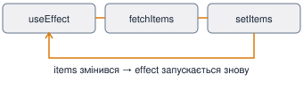
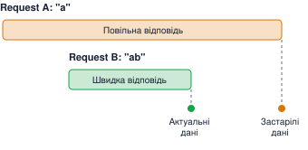

# Практичні завдання

## 9.1. Event Loop

<a id="q-9-1"></a>

Що виведеться в консоль і чому?

```javascript
console.log(1);

setTimeout(() => console.log(2), 0);

Promise.resolve().then(() => console.log(3));

console.log(4);
```

### Розв’язок

#### Interview answer (EN)

The output is 1, 4, 3, 2. Synchronous code runs first, then the Promise reaction, then the timer.

1 → 4 → 3 → 2

Спочатку виконується синхронний код — 1 та 4. Потім microtask із Promise — 3. Після цього task із setTimeout — 2.

## 9.2. Closure

<a id="q-9-2"></a>

Що виведеться? Як зміниться результат, якщо використати `let`?

```javascript
for (var i = 0; i < 3; i++) {
  setTimeout(() => console.log(i), 100);
}
```

### Розв’язок

#### Interview answer (EN)

Var shares one binding, so the callbacks log 3, 3, 3. Let creates one binding per iteration, so they log 0, 1, 2.

З `var` буде 3, 3, 3. З `let` буде 0, 1, 2.

`var` створює одну спільну змінну. До виконання callbacks цикл уже завершився, і `i` дорівнює 3.

`let` у циклі створює окремий binding для кожної ітерації, тому кожен callback отримує власне значення.

## 9.3. React State

<a id="q-9-3"></a>

Яке значення матиме `count` після одного натискання кнопки? Як зробити так, щоб воно збільшувалося на 3?

```typescript
const [count, setCount] = useState(0);

const handleClick = () => {
  setCount(count + 1);
  setCount(count + 1);
  setCount(count + 1);
};
```

### Розв’язок

#### Interview answer (EN)

Three direct assignments use the same snapshot. Three functional updates accumulate to 3.

Результат — 1, оскільки всі три виклики використовують `count` із поточного рендера, тобто 0.

```typescript
setCount(prev => prev + 1);
setCount(prev => prev + 1);
setCount(prev => prev + 1);
```

Functional updates послідовно отримують актуальний pending state 0 → 1 → 2 → 3.

## 9.4. useEffect

<a id="q-9-4"></a>

Що не так із цим кодом?

```typescript
const [items, setItems] = useState([]);

useEffect(() => {
  fetchItems().then(setItems);
}, [items]);
```

### Розв’язок

#### Interview answer (EN)

The effect depends on state that it updates. A fresh array can retrigger the fetch.

Виникає потенційний нескінченний цикл. Кожен запит зазвичай повертає новий масив, `setItems` змінює залежність, і effect повторюється.

Якщо дані потрібно отримати лише при монтуванні і `fetchItems` є стабільною зовнішньою функцією:

```typescript
useEffect(() => {
  fetchItems().then(setItems);
}, []);
```

У production також потрібно врахувати обробку помилок, cleanup та актуальність запиту. RTK Query дозволяє уникнути більшості цієї ручної логіки.



## 9.5. Reference vs Value

<a id="q-9-5"></a>

Що виведеться в консоль?

```javascript
const a = { user: { name: "Alex" } };
const b = { ...a };

b.user.name = "John";

console.log(a.user.name);
console.log(a === b);
console.log(a.user === b.user);
```

### Розв’язок

#### Interview answer (EN)

The output is John, false, true. The spread copies the outer object and shares the nested one.

```text
John
false
true
```

Spread operator створює shallow copy. Об'єкти `a` та `b` мають різні посилання, але їхні вкладені `user` вказують на той самий об'єкт.

Для незалежного копіювання вкладеного об'єкта:

```javascript
const b = {
  ...a,
  user: { ...a.user }
};
```

## 9.6. TypeScript Generics

<a id="q-9-6"></a>

Типізуй функцію так, щоб TypeScript автоматично визначав тип значення, що повертається, та не дозволяв передати неіснуючий ключ.

```typescript
function getProperty(obj, key) {
  return obj[key];
}

const user = { name: "Alex", age: 30 };

getProperty(user, "name");
getProperty(user, "age");
getProperty(user, "email"); // TypeScript error
```

### Розв’язок

#### Interview answer (EN)

Constrain the key to keyof T and return T[K] to preserve the selected property type.

```typescript
function getProperty<T, K extends keyof T>(
  obj: T,
  key: K
): T[K] {
  return obj[key];
}

const user = {
  name: "Alex",
  age: 30
};

getProperty(user, "name"); // string
getProperty(user, "age");  // number
getProperty(user, "email"); // TS error
```

`T` — тип об'єкта. `K` — один із його ключів. `T[K]` — тип значення відповідної властивості.

## 9.7. Реалізуй debounce

<a id="q-9-7"></a>

Реалізуй власну функцію `debounce` без використання сторонніх бібліотек.

### Розв’язок

#### Interview answer (EN)

Keep a timer in a closure, clear it on each call, and schedule the callback with the latest arguments.

```typescript
function debounce<Args extends unknown[]>(
  callback: (...args: Args) => void,
  delay: number
) {
  let timer: ReturnType<typeof setTimeout>;

  return (...args: Args) => {
    clearTimeout(timer);

    timer = setTimeout(() => {
      callback(...args);
    }, delay);
  };
}

const search = debounce((value: string) => {
  console.log("Search:", value);
}, 500);

search("a");
search("ab");
search("abc");
```

Якщо виклики відбулися без необхідної паузи, через 500 мс після останнього виклику буде виведено `Search: abc`.

Тут використовується closure для збереження `timer` між викликами. Generics зберігають типи аргументів callback.

## 9.8. Race Condition

<a id="q-9-8"></a>

Є поле пошуку, яке відправляє API-запит при зміні тексту. Старий запит повернув результат пізніше за новий і перезаписав актуальні дані. Як розв'язати цю проблему?

### Розв’язок

#### Interview answer (EN)

Cancel obsolete requests and guard state updates so stale results cannot overwrite the current search.

Варіант вирішення — скасовувати попередній запит та ігнорувати застарілі результати.

```typescript
useEffect(() => {
  const controller = new AbortController();
  let active = true;

  async function searchUsers() {
    try {
      const response = await fetch(
        `/api/users?q=${encodeURIComponent(search)}`,
        { signal: controller.signal }
      );

      if (!response.ok) {
        throw new Error("Request failed");
      }

      const data = await response.json();

      if (active) {
        setUsers(data);
      }
    } catch (error) {
      if (active && !controller.signal.aborted) {
        console.error(error);
      }
    }
  }

  searchUsers();

  return () => {
    active = false;
    controller.abort();
  };
}, [search]);
```

Інші варіанти: request IDs, перевірка актуальності результату або використання RTK Query, де кеш розділений за аргументами запитів.

Сам debounce не гарантує вирішення race condition, оскільки декілька запитів усе одно можуть виконуватися одночасно.



#### Пов’язані питання

- [Що таке debounce та throttle? Коли їх використовувати?](../01-javascript/README.md#q-1-13)
- [Як працює `AbortController`?](../06-browser-network/README.md#q-6-13)
